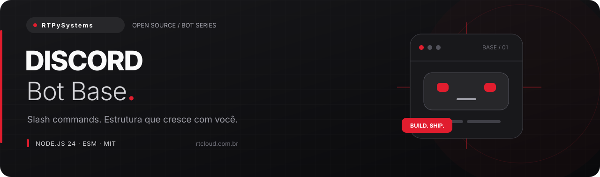
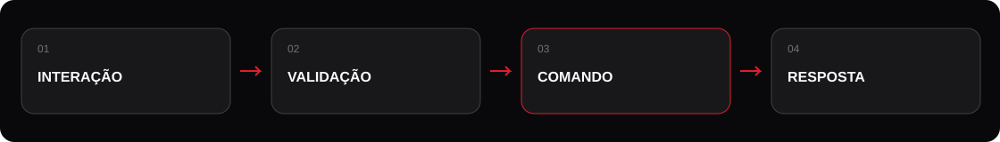

# Discord Bot Base

**Uma base enxuta para começar direito — e organizada para continuar crescendo.**

Projeto aberto de [RTPySystems](https://github.com/RTPySystems), desenvolvedor e criador da
[RTCloud](https://rtcloud.com.br). Sem arquivos gigantes ou configuração escondida: cada parte
tem seu lugar, do primeiro comando até o encerramento do processo.

[Começar](#começar) · [Configuração](#configuração) · [Estrutura](#estrutura) · [Deploy na RTCloud](#deploy-na-rtcloud) · [Operação](docs/OPERACAO.md)

## O que vem na base

| Recurso                   | Como funciona                                                                                                     |
| ------------------------- | ----------------------------------------------------------------------------------------------------------------- |
| **Comandos sem bagunça**  | Auto-loader recursivo, separado por categoria. O registro via REST é um passo explícito, fora da inicialização.   |
| **Acesso sob controle**   | Permissões do usuário e do bot verificadas em tempo de execução, além da configuração dos slash commands.         |
| **Pronto para evoluir**   | Eventos independentes, embeds com identidade visual, cooldown por usuário/comando e encerramento seguro.          |
| **Qualidade e segurança** | ESLint, Prettier, testes com `node:test`, CI configurada, configuração validada e logs sem conteúdo de conversas. |



## Começar

**Requisitos:** Node.js **24.17+ na linha 24 LTS**, npm e uma conta na plataforma do bot.
As dependências estão fixadas e o lockfile acompanha o projeto. Baixe ou clone este repositório,
entre na pasta e execute:

```bash
npm ci
cp .env.example .env
```

No Windows sem Bash, copie `.env.example` para `.env` pelo explorador. Preencha as variáveis
antes de iniciar; **nunca versione o arquivo `.env`**.

1. Crie uma aplicação no [Discord Developer Portal](https://discord.com/developers/applications).
2. Na aba **Bot**, gere o token e coloque em `DISCORD_TOKEN`. Não habilite intents privilegiadas: esta base usa apenas `Guilds`.
3. Copie o **Application ID** para `DISCORD_CLIENT_ID` e o ID do servidor de teste para `DISCORD_GUILD_ID`.
4. Convide o bot com os escopos `bot` e `applications.commands`. Conceda **Ver canais**, **Enviar mensagens** e **Incorporar links** nos canais usados. Não é necessário Administrador.
5. Registre os comandos no servidor de teste e inicie:

```bash
npm run commands:deploy
npm start
```

Para registrar globalmente, use `npm run commands:deploy -- --global`. O `PUT` substitui a lista inteira **desse escopo**. Comandos globais e de servidor coexistem: limpe o registro de testes antes da migração definitiva para não duplicar entradas. Não execute o registro a cada reinício.

> Sem credenciais ou aceite de conexão, `npm start` encerra com uma mensagem em português e código 1.
> Os testes não precisam de tokens nem de uma conexão com a plataforma.

## Comandos

| Comando   | Função                                   | Acesso             |
| --------- | ---------------------------------------- | ------------------ |
| `/ping`   | Latência do gateway em um embed.         | Todos              |
| `/help`   | Lista os comandos disponíveis para você. | Todos              |
| `/server` | Resumo do servidor.                      | Gerenciar servidor |

## Configuração

| Variável            | Obrigatória        | Padrão | Uso                                |
| ------------------- | ------------------ | ------ | ---------------------------------- |
| `DISCORD_TOKEN`     | Sim                | —      | Token do bot no Developer Portal.  |
| `DISCORD_CLIENT_ID` | Para registrar     | —      | Application ID, não é o token.     |
| `DISCORD_GUILD_ID`  | Registro de testes | —      | ID do servidor de desenvolvimento. |
| `LOG_LEVEL`         | Não                | `info` | Nível de log do Pino.              |

O `.env` é carregado pelos scripts `npm start` e `npm run dev`. Na hospedagem, prefira variáveis
no painel. Valores inválidos interrompem a inicialização; nenhuma credencial é incluída na mensagem.

## Estrutura

```text
src/
├── commands/
│   ├── admin/server.js
│   └── general/{help,ping}.js
├── events/                  # ready, interação e erro do cliente
├── handlers/                # auto-loader e fluxo de interação
├── lib/                     # embeds, logs, limites e shutdown
├── config.js
└── index.js
scripts/                     # registro REST e smoke test de startup
test/                        # testes sem conectar ao Discord
```

### Criar seu primeiro comando

Crie um arquivo em `src/commands/` (subpastas também são carregadas):

```js
import { SlashCommandBuilder } from 'discord.js';

export default {
  data: new SlashCommandBuilder().setName('ola').setDescription('Uma saudação rápida.'),
  cooldownSeconds: 3,
  async execute(interaction) {
    await interaction.reply('Olá!');
  },
};
```

Depois rode `npm run commands:deploy` novamente. Para uma tarefa lenta, use `await interaction.deferReply()` antes do trabalho e `editReply()` ao terminar; a primeira resposta precisa chegar dentro do prazo do Discord. Campos opcionais do módulo: `guildOnly`, `userPermissions`, `botPermissions` e `cooldownSeconds`.

## Deploy na RTCloud

A [RTCloud](https://rtcloud.com.br) hospeda bots, sites e APIs. O projeto não depende de SDK
proprietário: funciona também em qualquer ambiente compatível com Node.js 24.

1. Valide localmente: `npm run lint && npm test && npm run test:startup`.
2. Envie o código por **GitHub ou ZIP** no fluxo de deploy de bot. Exclua `node_modules`, `.git`, `.env` e sessões do pacote.
3. Selecione **Node.js 24**, instale com `npm ci --omit=dev` e use `npm start` como comando de execução (entrada: `src/index.js`).
4. Cadastre as variáveis da tabela no painel. Nunca coloque tokens no README ou no arquivo de entrada.
5. Abra o console, confira a mensagem de conexão e teste um comando. Esta base é um **worker/bot**, não um site HTTP; não expõe porta pública.

Confira as opções atuais na [documentação da RTCloud](https://docs.rtcloud.com.br).

**Discord:** registre os slash commands localmente antes do deploy. O registro não faz parte de `npm start` e não precisa rodar em cada reinicialização.

### Usar Docker

```bash
docker build -t discord-bot-base .
docker run --rm --init --env-file .env discord-bot-base
```

A imagem usa usuário sem privilégios, instala apenas dependências de produção e trata `SIGTERM`.
Não copie segredos para dentro da imagem. O Dockerfile é uma alternativa ao runtime Node da hospedagem.

## Desenvolvimento e verificação

```bash
npm run dev           # reinicia ao salvar
npm run lint          # ESLint
npm run format:check  # Prettier sem alterar arquivos
npm test              # testes unitários e de integração simulada
npm run test:startup  # valida saída segura sem credenciais
```

Para formatar, use `npm run format`. O workflow em `.github/workflows/ci.yml` executa instalação,
lint, formatação, testes e smoke test em cada push ou pull request. A CI está **configurada**;
a execução na plataforma depende da publicação do repositório.

## Limites e cuidados

Os cooldowns ficam em memória e são reiniciados com o processo. Em múltiplas instâncias, mova o estado para Redis e planeje sharding. Embeds dependem da permissão **Incorporar links**; restrições por canal continuam valendo. Não há banco de dados, painel web, música ou moderação destrutiva nesta base.

Logs são JSON para o console, sem gravar mensagens de usuários. A aplicação omite URL, mensagem
e stack dos erros de bibliotecas para evitar vazamento de credenciais; o tipo do erro permanece
para diagnóstico. Durante a operação, use os códigos e o contexto seguro do evento. `SIGINT` e
`SIGTERM` iniciam um encerramento com prazo de 10 segundos. Falhas fatais encerram com código 1.

## Contribuir e licença

Melhorias são bem-vindas. Veja [CONTRIBUTING.md](CONTRIBUTING.md) antes de abrir um PR.
Licença [MIT](LICENSE) — você pode estudar, adaptar e usar comercialmente, mantendo o aviso da licença.

### Referências técnicas

[Documentação do discord.js v14](https://discord.js.org/docs/packages/discord.js/14.28.1) · [Interações do Discord](https://discord.com/developers/docs/interactions/overview)

---

**RTPySystems** · Projetos com propósito, código com estrutura.  
[Perfil](https://github.com/RTPySystems) · [RTCloud](https://rtcloud.com.br) · [Documentação](https://docs.rtcloud.com.br)
